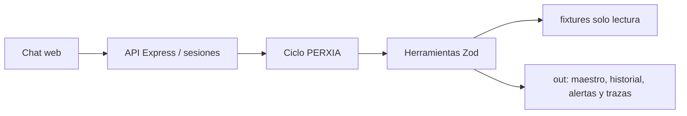

# SOLUCIÓN · Registro de contratos vigentes

## 1. Problema

Administración no tiene visibilidad confiable de contratos vigentes porque los comerciales los envían de forma dispersa; el agente centraliza recepción, registro y alertas sin decidir por el humano.

## 2. Arquitectura

El comportamiento vive en `agent/prompt.md`, el conocimiento en `src/knowledge/registro-contratos.md` y la ejecución determinista en `src/tools/contratos.ts`. El front muestra historial, estado de pensamiento, cada tool call y una confirmación resaltada.

## 3. Ciclo del agente

Por turno se lee el buzón, se extrae, valida y registra cada mensaje. El runtime conserva sesión en memoria, limita el lote a `MAX_ITERATIONS` y captura fallos por mensaje. Si `requiere_revision` contiene campos con confianza menor de 0.8, almacena el contrato como pendiente y solo registra en el siguiente turno cuando el usuario confirma. Las herramientas devuelven JSON `{ ok, data | error }`, nunca lanzan al ciclo.

## 4. Modelo

La entrega usa `DeterministicPerxiaAdapter` como predeterminado para que demo y defensa no dependan de credenciales ni costo externo. `LlmAdapter` define el contrato de interpretación y `src/llm/factory.ts` elige el adaptador por `LLM_PROVIDER`.

Se reutilizó la integración de OpenCode Go del proyecto `ai_agent-supplier-register`: `OpenCodeGoAdapter` usa `@anthropic-ai/sdk`, el endpoint OpenCode compatible con Messages, `OPENCODE_API_KEY` solo en backend y el encabezado `x-opencode-session`. En este reto el modelo no recibe poder de registro: solo selecciona una intención mediante tool use estructurado; el runtime y las herramientas tipadas mantienen la extracción, validación, confirmación y escritura bajo controles locales. Costo actual en modo PERXIA: $0 por caso.

## 5. Extracción y confianza

Regex y heurísticas leen identificador, partes, NIT/RUC, objeto, moneda, valor, fechas, plazo y póliza desde el `.txt`. Los campos ausentes quedan `null` y confianza 0. El valor indeterminado y una fecha fin derivada por plazo quedan en 0.65; un remitente desconocido en 0.6 y se reporta, sin bloquear. Duplicado significa mismo ID, valor y fechas; otrosí o cambios sobre el mismo ID actualizan y conservan historial.

## 6. Regla de gobierno

| Tema | Regla |
|---|---|
| Canal único | `contratos@periferia-ficticia.com`, administrado por la analista administrativa. |
| Obligación comercial | Dentro de 24 horas de firma debe enviar PDF firmado, otrosíes y actas de terminación; asunto: `CONTRATO/OTROSÍ - Cliente - ID`. |
| Acuse | El agente responde acuse y estado inicial el mismo día hábil. |
| Excepciones | Sin firma o valor: queda en revisión y se escala al líder comercial; administración no inventa datos. |
| Cierre de gap | Campaña única junio-agosto 2026: cada comercial carga su listado, adjunta soportes y administración concilia con facturación. |
| Indicador | % mensual de contratos facturados que existen en maestro, meta ≥ 98%. |

## 7. Decisiones y trade-offs

1. **CSV en `out/` en vez de base de datos:** permite trazabilidad, demo portable y protege el fixture; para producción migraría a SharePoint/BD con control de concurrencia.
2. **Extracción determinista antes que LLM:** cubre fixtures y evita inventar campos; se sacrifica flexibilidad ante formatos nuevos.
3. **Confirmación por conversación:** mantiene control humano sobre baja confianza; aumenta un turno frente a registrar automáticamente.
4. **Sin OCR P0:** los textos son nativos según el reto; producción requeriría OCR y cola de revisión para escaneados.

## 8. Supuestos

Los adjuntos de contrato tienen texto extraíble, el maestro es la fuente inicial confiable y la fecha del correo representa la fecha de registro del buzón.

## 9. Cobertura

| Historia | Estado | Evidencia |
|---|---|---|
| HU-1 Leer buzón | Hecho | `contratos_leer_buzon` y demo |
| HU-2 Extraer | Hecho | `contratos_extraer` con confianza |
| HU-3 Validar | Hecho | clasificación, comercial y revisión |
| HU-4 Registrar | Hecho | copia del maestro, archivo e historial |
| HU-5 Alertar | Hecho | `out/alertas.md` |
| HU-6 Errores | Hecho | resultados tipados y continuidad por mensaje |

Para producción faltan autenticación, Exchange/SharePoint reales, OCR, persistencia transaccional, observabilidad y despliegue público.

## 10. Uso de IA

Se utilizó PERXIA para analizar el PRD, estructurar el proyecto, implementar TypeScript, revisar consistencia con los fixtures y generar documentación. Se descartó registrar campos de confianza baja automáticamente y cualquier propuesta que modificara los fixtures.

## 11. Riesgos y mitigación

- Formatos nuevos o escaneados: OCR, pruebas de regresión y cola humana.
- Conflictos concurrentes del maestro: almacenamiento transaccional y versionado.
- Datos sensibles: control de acceso, cifrado y retención mínima.
- Dependencia de que comerciales envíen documentos: indicador mensual y escalamiento definido en la regla de gobierno.
